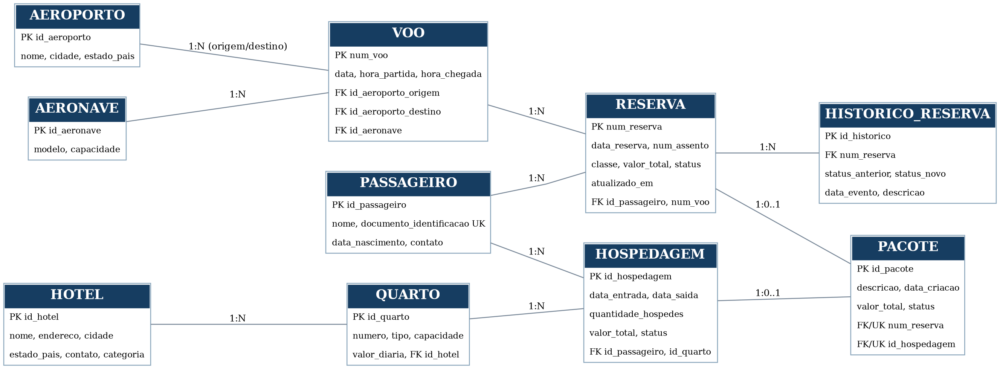
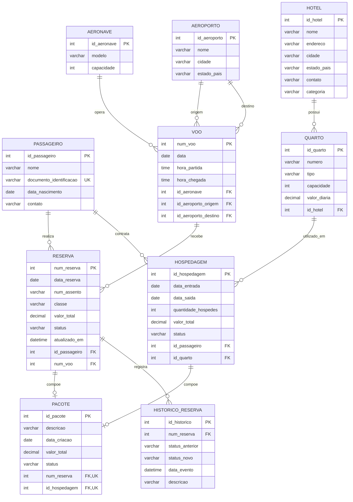

# ✈️ IN-DOALI — Sistema de Reserva de Passagens Aéreas

**Projeto de Dados Final · Infoweb 2V**  
**Grupo:** João Gabriel · Allan Vyctor · João Henrique · Micaías Tavares  
**Branch exigida para entrega:** `projeto-dados-final`

## 1. Descrição do sistema

Sistema fictício de reservas de passagens aéreas, hospedagens e pacotes de viagem. O modelo relacional organiza passageiros, voos, aeronaves, aeroportos, reservas, hotéis, quartos, hospedagens, pacotes e histórico de reservas. A aplicação Python existente nas branches `main`/`feat-modelos` usa atualmente estruturas em memória e arquivos `.txt`; o planejamento final prevê integrar essas classes ao MySQL por repositórios/DAOs.

## 2. SGBD e estrutura

- SGBD: **MySQL 8.0.16+**, banco: **`aerobrasil_reservas`** (nome técnico preservado para compatibilidade com a atividade anterior; marca do estudo de caso: IN-DOALI).
- Tabelas: **10**. O banco anterior tinha cinco tabelas físicas e 1.000 registros.
- As 1.000 linhas de teste anteriores permanecem no `database.sql` com seus identificadores originais.
- Foram adicionadas `hotel`, `quarto`, `hospedagem`, `pacote`, `historico_reserva`, assim como os campos `reserva.status` e `reserva.atualizado_em`.
- Não se preencheu retroativamente `atualizado_em` dos registros antigos; os 400 históricos iniciais correspondentes indicam estado **importado**, sem pretender comprovar ações de usuários.

## 3. DER atualizado

**Cardinalidades:** passageiro 1:N reserva; aeronave 1:N voo; aeroporto 1:N voo (origem e destino); voo 1:N reserva; hotel 1:N quarto; quarto 1:N hospedagem; passageiro 1:N hospedagem; reserva 1:0..1 pacote; hospedagem 1:0..1 pacote; reserva 1:N histórico. Restrições: integridade referencial, assento único por voo e unicidade dos componentes de cada pacote. Conflitos de hospedagem/lotação são regras de negócio a verificar na aplicação.

## 4. Distribuição dos dados

| Tabela | Registros |
| --- | ---: |
| `passageiro` | 650 |
| `aeronave` | 25 |
| `aeroporto` | 25 |
| `voo` | 300 |
| `reserva` | 900 |
| `hotel` | 35 |
| `quarto` | 140 |
| `hospedagem` | 400 |
| `pacote` | 180 |
| `historico_reserva` | 900 |
| **Total** | **3.555** |

A base original de 1.000 registros foi mantida, e foram inseridos 2.555 adicionais. A massa fictícia foi gerada com apoio de IA e scripts determinísticos; a equipe deve executar e conferir o resultado no MySQL local antes da entrega. São oferecidas consultas de contagem ao final do `database.sql`.

## 5. Relatórios SQL

1. **Reservas por mês e status:** volume de operações e valores associados por período; permite acompanhar pendências e cancelamentos.
2. **Voos com maior movimentação:** comparação de reservas válidas e capacidade da aeronave, para planejamento operacional.
3. **Hospedagens e pacotes por cidade/categoria:** acompanha uso da rede hoteleira e volume de pacotes.
4. **Histórico de reservas (complementar):** apresenta estados registrados por reserva, passageiro e data.

As quatro consultas completas e suas finalidades também constam em [`relatorios.pdf`](relatorios.pdf).

## 6. Escopo planejado para POO

**Prioridade alta:** cadastro, consulta e manutenção de passageiros/voos; busca de voos; criação, alteração de status e cancelamento de reservas; alocação de assentos e verificação de capacidade; persistência em MySQL e geração dos relatórios SQL.

**Prioridade média:** hotéis e quartos, criação de hospedagens com verificação de sobreposição de datas; associação 1:1 opcional de reserva e hospedagem em pacote; consulta dos históricos de alteração de status.

**Evolução posterior (dependente do tempo):** autenticação por perfis, notificações externas, pagamentos reais e emissão de comprovantes. Exclusões de itens com histórico devem ser restringidas; preferir cancelamento e preservação das operações.

**Arquitetura:** classes `Passageiro`, `Voo`, `Reserva`, `Hotel`, `Quarto`, `Hospedagem`, `Pacote` e `HistoricoReserva`; acesso por DAOs/repositórios; serviços para regras de negócio; interface GUI ou terminal existente como cliente. `Aeroporto` e `Aeronave` também devem ser representados na camada de domínio.

## 7. Como executar

1. Instale ou acesse **MySQL 8.0.16+** com permissão para criar bancos de dados.
2. Abra o MySQL Workbench e execute todo o conteúdo de `database.sql`, ou execute no terminal: `mysql -u seu_usuario -p < database.sql`.
3. O script cria/seleciona `aerobrasil_reservas`, remove as tabelas do modelo (somente desse banco), recria as 10 tabelas, preserva a massa original e insere a expansão.
4. Confirme a consulta de contagem final: **3.555** registros. Atenção: **executar o script novamente recria as tabelas**, portanto use apenas em ambiente de testes e faça backup se houver dados próprios.
5. Os relatórios podem ser executados no mesmo banco, usando as consultas do PDF.

## 8. Arquivos

- [`database.sql`](database.sql): estrutura e 3.555 registros, reproduzíveis a partir de banco vazio.
- [`relatorios.pdf`](relatorios.pdf): análise da evolução, DER, massa de dados, SQL e escopo de POO.
- [`der_atualizado.png`](der_atualizado.png): imagem do DER.

## 9. Versionamento

A evolução do projeto deve ser publicada na branch `projeto-dados-final` do mesmo repositório, preservando o histórico das etapas anteriores.
