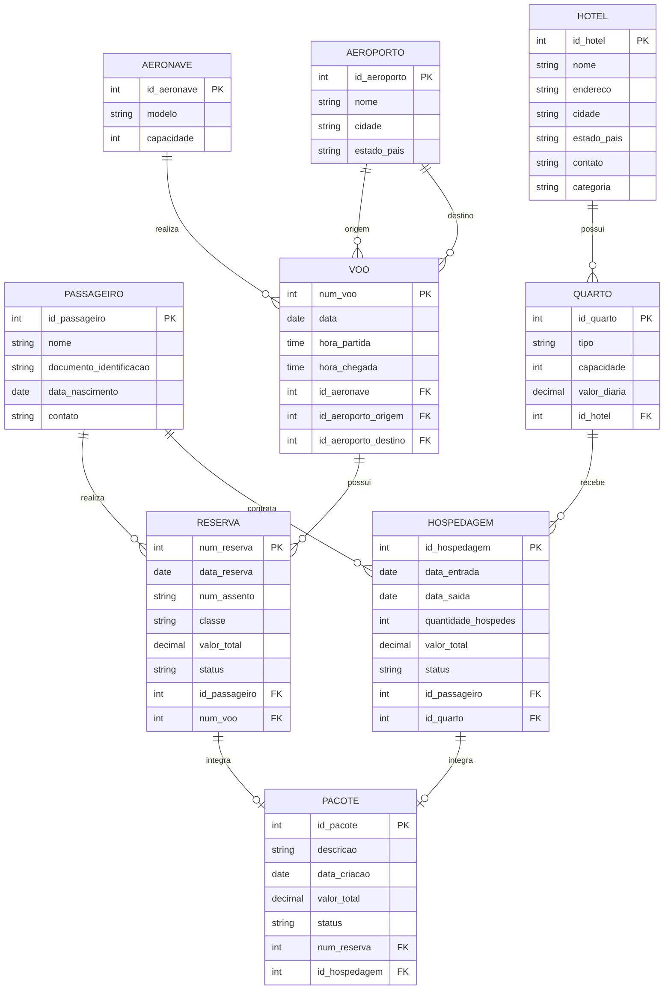

# ✈️ Sistema de Reserva de Passagens Aéreas — IN-DOALI

## 👥 Equipe

**Projeto:** Sistema de Reserva de Passagens Aéreas

**Empresa fictícia:** IN-DOALI

**Integrantes:**
- João Gabriel
- Allan Vyctor
- João Henrique
- Micaías Tavares

**Turma:** Infoweb 2V

---

## 💻 Sobre o projeto

O Sistema de Reserva de Passagens Aéreas foi desenvolvido com o objetivo de centralizar e organizar as informações relacionadas às operações da IN-DOALI, incluindo passageiros, voos, aeronaves, aeroportos, reservas aéreas, hotéis, quartos, hospedagens e pacotes de viagem.

Com o crescimento da quantidade de voos, passageiros e serviços oferecidos, tornou-se necessário desenvolver uma solução capaz de facilitar o gerenciamento das informações e dos pedidos realizados pelos clientes.

A proposta do sistema é permitir que os funcionários consultem e gerenciem os dados das operações da companhia em uma estrutura integrada, facilitando o controle das reservas, a disponibilidade dos serviços e a organização das viagens.

Além das reservas de passagens aéreas, o sistema contempla serviços de hospedagem e a criação de pacotes de viagem que combinam uma reserva aérea com uma hospedagem.

---

## 🎯 Objetivos

### Objetivo geral

Desenvolver um sistema para gerenciar as operações de uma companhia aérea, integrando reservas de passagens, hospedagens e pacotes de viagem em um único banco de dados.

### Objetivos específicos

- Organizar os cadastros de passageiros, aeronaves, aeroportos e hotéis.
- Gerenciar voos, reservas aéreas, quartos e hospedagens.
- Controlar a disponibilidade de assentos e acomodações.
- Permitir a criação de pacotes que combinem passagens aéreas e hospedagens.
- Centralizar a consulta dos pedidos realizados.
- Permitir o cancelamento de reservas, hospedagens e pacotes por meio da consulta de pedidos.
- Garantir a integridade e a consistência das informações armazenadas no banco de dados.

---

## 📌 Escopo do sistema

O sistema será organizado em oito módulos principais:

1. **Passageiros:** cadastro, consulta e atualização dos dados dos passageiros.
2. **Voos e infraestrutura aérea:** gerenciamento de voos, aeronaves e aeroportos.
3. **Reservas aéreas:** criação e consulta de reservas de passagens.
4. **Hotéis e quartos:** cadastro e gerenciamento dos hotéis e de suas acomodações.
5. **Hospedagens:** gerenciamento das estadias e verificação da disponibilidade dos quartos.
6. **Pacotes de viagem:** associação de uma reserva aérea a uma hospedagem.
7. **Consulta de pedidos e cancelamentos:** consulta dos pedidos e gerenciamento de seus cancelamentos.
8. **Banco de dados:** persistência, consulta e integridade das informações.

O gerenciamento dos quartos será realizado dentro do módulo de hotéis. Da mesma forma, os cancelamentos serão centralizados no módulo de consulta de pedidos, evitando que essa operação seja executada diretamente pelos demais módulos.

---

## ✈️ Cenário de utilização

A IN-DOALI realiza voos entre diferentes aeroportos e oferece serviços de hospedagem por meio de hotéis cadastrados no sistema.

Cada passageiro possui um cadastro com suas informações pessoais e pode realizar diversas reservas de passagens aéreas e hospedagens ao longo do tempo.

### Voos e reservas aéreas

Os voos possuem informações como número de identificação, data, horário de partida e horário previsto de chegada. Cada voo possui um aeroporto de origem, um aeroporto de destino e uma aeronave responsável pela viagem.

Uma aeronave pode ser utilizada em diferentes voos ao longo do tempo, enquanto cada voo é associado a uma única aeronave.

As reservas armazenam informações como data da reserva, número do assento, classe da passagem, valor total e os identificadores do passageiro e do voo correspondente.

### Hotéis, quartos e hospedagens

O sistema mantém o cadastro dos hotéis, incluindo nome, endereço, cidade, estado ou país, contato e categoria.

Cada hotel pode possuir diversos quartos. Os quartos armazenam informações como tipo, capacidade de hóspedes e valor da diária.

As hospedagens registram as estadias contratadas pelos passageiros, incluindo data de entrada, data de saída, quantidade de hóspedes e valor total. Cada hospedagem está associada a um passageiro responsável e a um quarto específico.

Antes de confirmar uma hospedagem, o sistema deverá verificar se o quarto possui disponibilidade durante todo o período solicitado, considerando as hospedagens já registradas e não canceladas.

### Pacotes de viagem

O sistema permite criar pacotes que combinam uma reserva de passagem aérea e uma hospedagem.

Cada pacote possui um identificador, uma descrição, uma data de criação e um valor total. Ele referencia uma reserva aérea e uma hospedagem previamente registradas.

Para evitar inconsistências, a criação do pacote deverá verificar a existência dos dois registros, a situação dos serviços associados e a compatibilidade entre o passageiro responsável e as datas da viagem e da estadia.

Nesta versão do modelo, cada pacote reúne exatamente uma reserva aérea e uma hospedagem. Uma reserva ou hospedagem poderá ser vinculada a, no máximo, um pacote.

### Consulta de pedidos e cancelamentos

O módulo de consulta de pedidos centraliza o acesso às reservas aéreas, hospedagens e pacotes.

Por meio dele, os funcionários poderão consultar os detalhes de cada pedido e realizar os cancelamentos permitidos pelo sistema.

O cancelamento deverá atualizar a situação do pedido e preservar seu histórico no banco de dados. Quando um pacote for cancelado, a regra definida para o sistema será cancelar também a reserva aérea e a hospedagem vinculadas, mantendo a consistência das informações.

---

## ⭐ Principais funcionalidades

### Passageiros
- Cadastrar passageiros.
- Atualizar dados cadastrais.
- Consultar as reservas e hospedagens associadas a um passageiro.

### Voos e infraestrutura aérea
- Cadastrar e consultar voos.
- Gerenciar aeronaves.
- Gerenciar aeroportos.
- Consultar os passageiros vinculados às reservas de um voo.
- Consultar a capacidade e a ocupação dos voos.

### Reservas aéreas
- Criar reservas de passagens.
- Consultar reservas.
- Definir assento e classe da passagem.
- Calcular o valor da reserva.
- Verificar a disponibilidade de assentos.

### Hotéis e quartos
- Cadastrar e consultar hotéis.
- Atualizar os dados dos hotéis.
- Cadastrar e gerenciar quartos.
- Consultar tipos de quarto, capacidades e valores das diárias.
- Consultar os quartos associados a cada hotel.

### Hospedagens
- Consultar hospedagens.
- Definir datas de entrada e saída.
- Informar a quantidade de hóspedes.
- Calcular o valor total da estadia.
- Verificar a disponibilidade dos quartos no período solicitado.

### Pacotes de viagem
- Criar pacotes de viagem.
- Vincular uma reserva aérea a uma hospedagem.
- Calcular e registrar o valor total do pacote.
- Consultar os pacotes cadastrados e seus serviços associados.

### Consulta de pedidos e cancelamentos
- Consultar reservas aéreas.
- Consultar hospedagens.
- Consultar pacotes.
- Consultar os detalhes dos pedidos.
- Cancelar pedidos conforme as regras estabelecidas.
- Atualizar a situação dos pedidos e preservar seus registros.

---

## 🗄️ Modelo lógico do banco de dados

O banco de dados será composto por nove relações principais: `PASSAGEIRO`, `AERONAVE`, `AEROPORTO`, `VOO`, `RESERVA`, `HOTEL`, `QUARTO`, `HOSPEDAGEM` e `PACOTE`.

### 1. PASSAGEIRO

Armazena os dados pessoais dos passageiros cadastrados.

- `id_passageiro` — chave primária (PK).
- `nome`
- `documento_identificacao`
- `data_nascimento`
- `contato`

### 2. AERONAVE

Armazena os dados das aeronaves utilizadas pela companhia.

- `id_aeronave` — chave primária (PK).
- `modelo`
- `capacidade`

### 3. AEROPORTO

Armazena os dados dos aeroportos utilizados nas viagens.

- `id_aeroporto` — chave primária (PK).
- `nome`
- `cidade`
- `estado_pais`

### 4. VOO

Armazena os dados dos voos e suas relações com aeronaves e aeroportos.

- `num_voo` — chave primária (PK).
- `data`
- `hora_partida`
- `hora_chegada`
- `id_aeronave` — chave estrangeira (FK) para `AERONAVE`.
- `id_aeroporto_origem` — chave estrangeira (FK) para `AEROPORTO`.
- `id_aeroporto_destino` — chave estrangeira (FK) para `AEROPORTO`.

### 5. RESERVA

Armazena os dados das reservas de passagens aéreas.

- `num_reserva` — chave primária (PK).
- `data_reserva`
- `num_assento`
- `classe`
- `valor_total`
- `status`
- `id_passageiro` — chave estrangeira (FK) para `PASSAGEIRO`.
- `num_voo` — chave estrangeira (FK) para `VOO`.

O atributo `status` permite identificar se a reserva está ativa ou cancelada.

### 6. HOTEL

Armazena as informações dos hotéis cadastrados.

- `id_hotel` — chave primária (PK).
- `nome`
- `endereco`
- `cidade`
- `estado_pais`
- `contato`
- `categoria`

### 7. QUARTO

Armazena os dados dos quartos pertencentes aos hotéis.

- `id_quarto` — chave primária (PK).
- `tipo`
- `capacidade`
- `valor_diaria`
- `id_hotel` — chave estrangeira (FK) para `HOTEL`.

### 8. HOSPEDAGEM

Armazena as informações das estadias contratadas pelos passageiros.

- `id_hospedagem` — chave primária (PK).
- `data_entrada`
- `data_saida`
- `quantidade_hospedes`
- `valor_total`
- `status`
- `id_passageiro` — chave estrangeira (FK) para `PASSAGEIRO`.
- `id_quarto` — chave estrangeira (FK) para `QUARTO`.

O atributo `status` permite controlar a situação da hospedagem, distinguindo estadias ativas de hospedagens canceladas.

### 9. PACOTE

Armazena os pacotes que integram uma reserva aérea e uma hospedagem.

- `id_pacote` — chave primária (PK).
- `descricao`
- `data_criacao`
- `valor_total`
- `status`
- `num_reserva` — chave estrangeira (FK) para `RESERVA`.
- `id_hospedagem` — chave estrangeira (FK) para `HOSPEDAGEM`.

As chaves estrangeiras `num_reserva` e `id_hospedagem` deverão possuir restrições de unicidade para garantir que cada reserva e cada hospedagem estejam vinculadas a, no máximo, um pacote.

O atributo `status` permite identificar os pacotes ativos ou cancelados.

---

## 📊 Diagrama Entidade-Relacionamento (ER)

O diagrama a seguir representa as entidades do sistema, seus atributos principais e os relacionamentos entre elas.



---

## 🔗 Relacionamentos

O modelo lógico apresenta os seguintes relacionamentos:

- **PASSAGEIRO e RESERVA:** um passageiro pode realizar nenhuma ou várias reservas, enquanto cada reserva pertence a exatamente um passageiro.
- **VOO e RESERVA:** um voo pode possuir nenhuma ou várias reservas, enquanto cada reserva está vinculada a exatamente um voo.
- **AERONAVE e VOO:** uma aeronave pode ser utilizada em nenhum ou vários voos, enquanto cada voo é realizado por exatamente uma aeronave.
- **AEROPORTO e VOO — origem:** um aeroporto pode ser origem de nenhum ou vários voos, enquanto cada voo possui exatamente um aeroporto de origem.
- **AEROPORTO e VOO — destino:** um aeroporto pode receber nenhum ou vários voos, enquanto cada voo possui exatamente um aeroporto de destino.
- **HOTEL e QUARTO:** um hotel pode possuir nenhum ou vários quartos, enquanto cada quarto pertence a exatamente um hotel.
- **QUARTO e HOSPEDAGEM:** um quarto pode estar associado a nenhuma ou várias hospedagens ao longo do tempo, enquanto cada hospedagem utiliza exatamente um quarto.
- **PASSAGEIRO e HOSPEDAGEM:** um passageiro pode contratar nenhuma ou várias hospedagens, enquanto cada hospedagem possui exatamente um passageiro responsável.
- **RESERVA e PACOTE:** uma reserva pode não integrar nenhum pacote ou integrar um único pacote, enquanto cada pacote possui exatamente uma reserva aérea.
- **HOSPEDAGEM e PACOTE:** uma hospedagem pode não integrar nenhum pacote ou integrar um único pacote, enquanto cada pacote possui exatamente uma hospedagem.

As duas relações entre `AEROPORTO` e `VOO` são representadas separadamente porque o aeroporto exerce dois papéis diferentes: origem e destino.

A relação entre `QUARTO` e `HOSPEDAGEM` não significa que um quarto possa ser ocupado por várias hospedagens simultaneamente. A disponibilidade no período deverá ser validada pelas regras de negócio do sistema.

---

## 📌 Estrutura das relações

A representação textual do modelo lógico é apresentada a seguir.

```text
PASSAGEIRO(
    id_passageiro PK,
    nome,
    documento_identificacao,
    data_nascimento,
    contato
)

AERONAVE(
    id_aeronave PK,
    modelo,
    capacidade
)

AEROPORTO(
    id_aeroporto PK,
    nome,
    cidade,
    estado_pais
)

VOO(
    num_voo PK,
    data,
    hora_partida,
    hora_chegada,
    id_aeronave FK,
    id_aeroporto_origem FK,
    id_aeroporto_destino FK
)

RESERVA(
    num_reserva PK,
    data_reserva,
    num_assento,
    classe,
    valor_total,
    status,
    id_passageiro FK,
    num_voo FK
)

HOTEL(
    id_hotel PK,
    nome,
    endereco,
    cidade,
    estado_pais,
    contato,
    categoria
)

QUARTO(
    id_quarto PK,
    tipo,
    capacidade,
    valor_diaria,
    id_hotel FK
)

HOSPEDAGEM(
    id_hospedagem PK,
    data_entrada,
    data_saida,
    quantidade_hospedes,
    valor_total,
    status,
    id_passageiro FK,
    id_quarto FK
)

PACOTE(
    id_pacote PK,
    descricao,
    data_criacao,
    valor_total,
    status,
    num_reserva FK UNIQUE,
    id_hospedagem FK UNIQUE
)
```

---

## ⚙️ Regras de negócio

Para garantir o funcionamento correto do sistema, serão adotadas as seguintes regras:

### Reservas aéreas

1. Toda reserva deverá estar vinculada a um passageiro e a um voo existentes.
2. Cada voo deverá possuir uma aeronave, um aeroporto de origem e um aeroporto de destino.
3. O aeroporto de origem deverá ser diferente do aeroporto de destino.
4. Um assento não poderá estar associado a mais de uma reserva ativa no mesmo voo.
5. A quantidade de reservas ativas não poderá ultrapassar a capacidade da aeronave.

### Hotéis e hospedagens

1. Todo quarto deverá pertencer a um hotel cadastrado.
2. Toda hospedagem deverá estar vinculada a um passageiro e a um quarto existentes.
3. A data de entrada deverá ser anterior à data de saída.
4. A quantidade de hóspedes não poderá ultrapassar a capacidade do quarto.
5. Um quarto não poderá possuir hospedagens ativas com períodos conflitantes.
6. O valor da hospedagem deverá considerar a quantidade de diárias e o valor aplicável ao quarto.

### Pacotes de viagem

1. Todo pacote deverá estar vinculado a uma reserva aérea e a uma hospedagem existentes.
2. A reserva e a hospedagem deverão pertencer ao mesmo passageiro responsável.
3. A data da hospedagem deverá ser compatível com o período da viagem.
4. Os serviços associados ao pacote deverão estar em situação válida no momento da contratação.
5. O valor total deverá ser calculado conforme a política de preços definida para o pacote.
6. Uma reserva ou hospedagem não poderá ser vinculada a mais de um pacote.
7. O cancelamento de um pacote deverá atualizar a situação do pacote e dos serviços associados conforme a regra definida para o sistema.

### Cancelamentos

1. Os cancelamentos serão realizados exclusivamente pelo módulo de consulta de pedidos.
2. O sistema deverá identificar se o pedido consultado corresponde a uma reserva, hospedagem ou pacote.
3. Um pedido já cancelado não deverá ser cancelado novamente.
4. Os registros cancelados deverão ser preservados para consulta e histórico.
5. O cancelamento de um pacote deverá atualizar seus serviços associados de forma consistente, utilizando uma transação no banco de dados.

---

## 🧩 Organização dos módulos

O sistema será desenvolvido em Python utilizando Programação Orientada a Objetos (POO), com o MySQL como sistema gerenciador de banco de dados.

A estrutura será organizada em módulos responsáveis por diferentes partes do sistema.

### 1. Passageiros
Responsável pelo cadastro, consulta e atualização das informações dos passageiros.

### 2. Voos e infraestrutura aérea
Responsável pelo gerenciamento de voos, aeronaves e aeroportos, incluindo a consulta dos passageiros associados às reservas.

### 3. Reservas aéreas
Responsável pela criação e consulta das reservas de passagens, além da verificação de assentos e capacidade dos voos.

### 4. Hotéis e quartos
Responsável pelo cadastro e gerenciamento dos hotéis e de suas acomodações.

### 5. Hospedagens
Responsável pelas estadias dos passageiros, incluindo datas, valores e disponibilidade dos quartos.

### 6. Pacotes de viagem
Responsável pela associação entre reservas aéreas e hospedagens, além do cálculo e da consulta dos pacotes.

### 7. Consulta de pedidos e cancelamentos
Responsável pela consulta centralizada dos pedidos e pelo gerenciamento dos cancelamentos.

### 8. Banco de dados
Responsável pela conexão com o MySQL, execução das consultas SQL e integridade dos dados.

A arquitetura deverá separar as classes de modelo, as regras de negócio, as operações de acesso ao banco e a interface de menus, facilitando a manutenção e a evolução do sistema.

```text
aerobrasil/
│
├── main.py
│
├── config/
│   ├── __init__.py
│   └── conexao.py
│
├── modelos/
│   ├── __init__.py
│   ├── passageiro.py
│   ├── aeronave.py
│   ├── aeroporto.py
│   ├── voo.py
│   ├── reserva.py
│   ├── hotel.py
│   ├── quarto.py
│   ├── hospedagem.py
│   └── pacote.py
│
├── passageiros/
│   ├── __init__.py
│   └── passageiro_service.py
│
├── voos/
│   ├── __init__.py
│   └── voo_service.py
│
├── reservas/
│   ├── __init__.py
│   └── reserva_service.py
│
├── hoteis/
│   ├── __init__.py
│   └── hotel_service.py
│
├── hospedagens/
│   ├── __init__.py
│   └── hospedagem_service.py
│
├── pacotes/
│   ├── __init__.py
│   └── pacote_service.py
│
├── pedidos/
│   ├── __init__.py
│   └── pedido_service.py
│
├── banco/
│   ├── __init__.py
│   ├── passageiro_repository.py
│   ├── voo_repository.py
│   ├── reserva_repository.py
│   ├── hotel_repository.py
│   ├── hospedagem_repository.py
│   └── pacote_repository.py
│
├── menus/
│   ├── __init__.py
│   ├── menu_principal.py
│   ├── menu_passageiros.py
│   ├── menu_aereo.py
│   ├── menu_reservas.py
│   ├── menu_hoteis.py
│   ├── menu_hospedagens.py
│   ├── menu_pacotes.py
│   └── menu_pedidos.py
│
└── sql/
    ├── schema.sql
    └── dados_teste.sql
```
